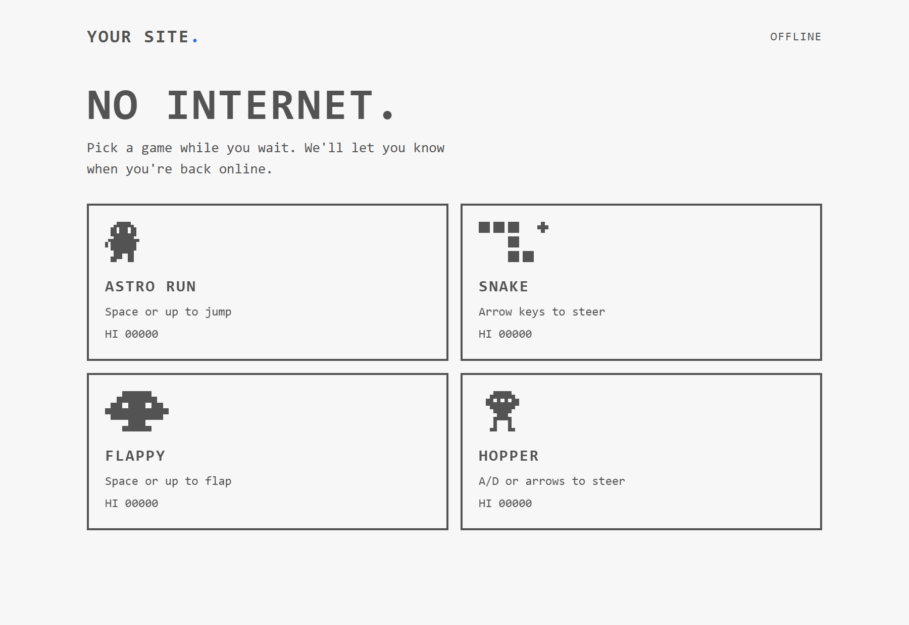
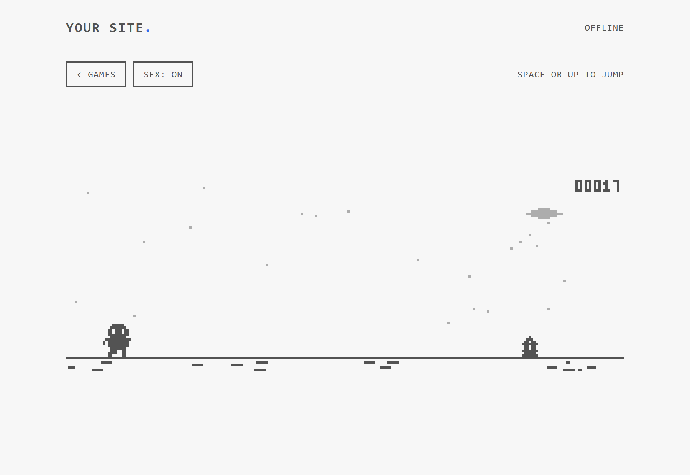
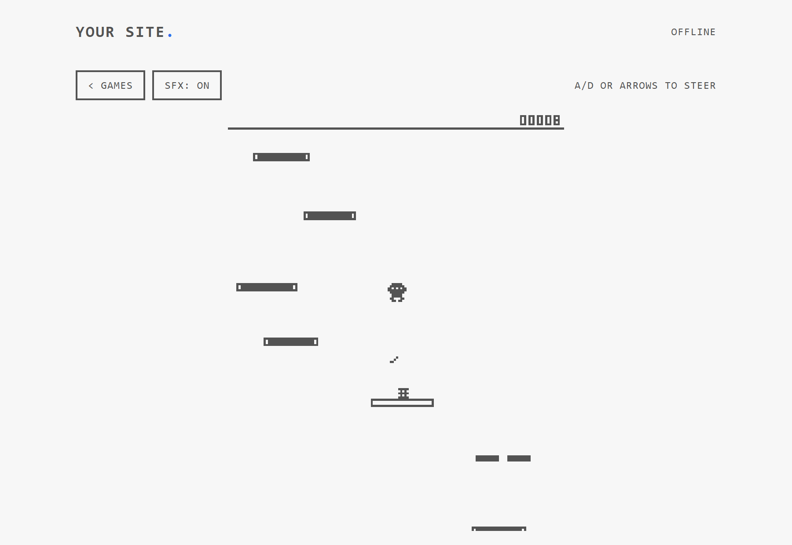
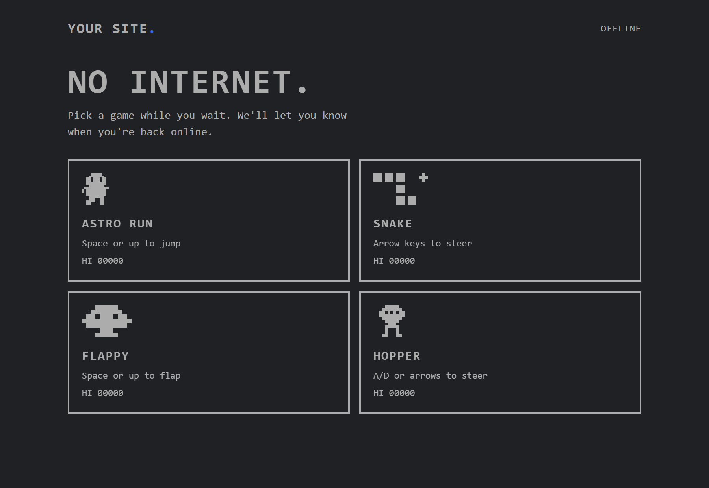
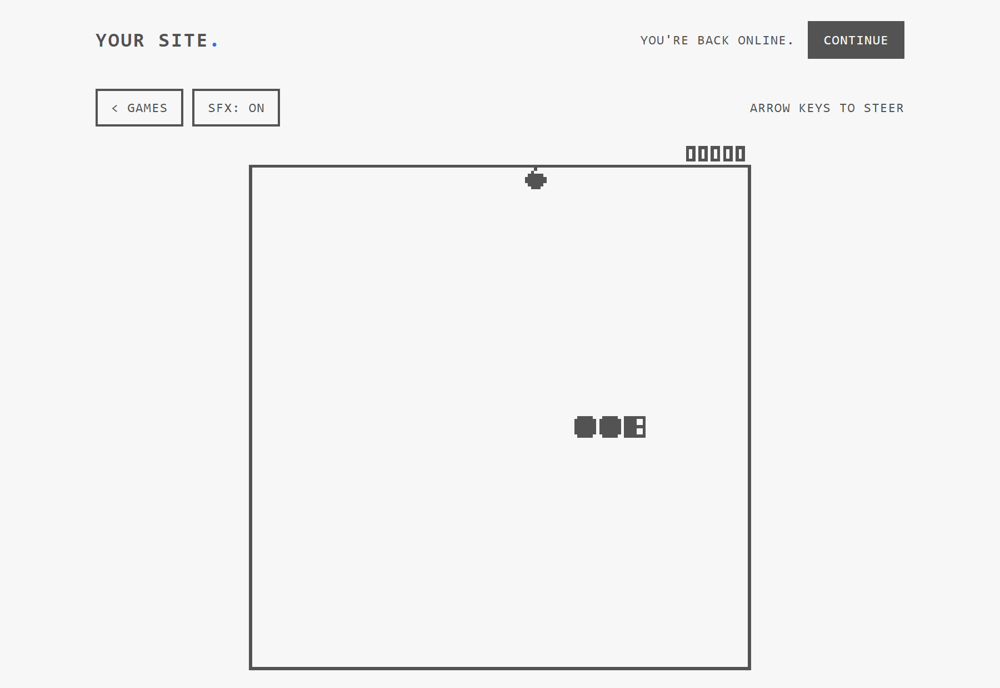
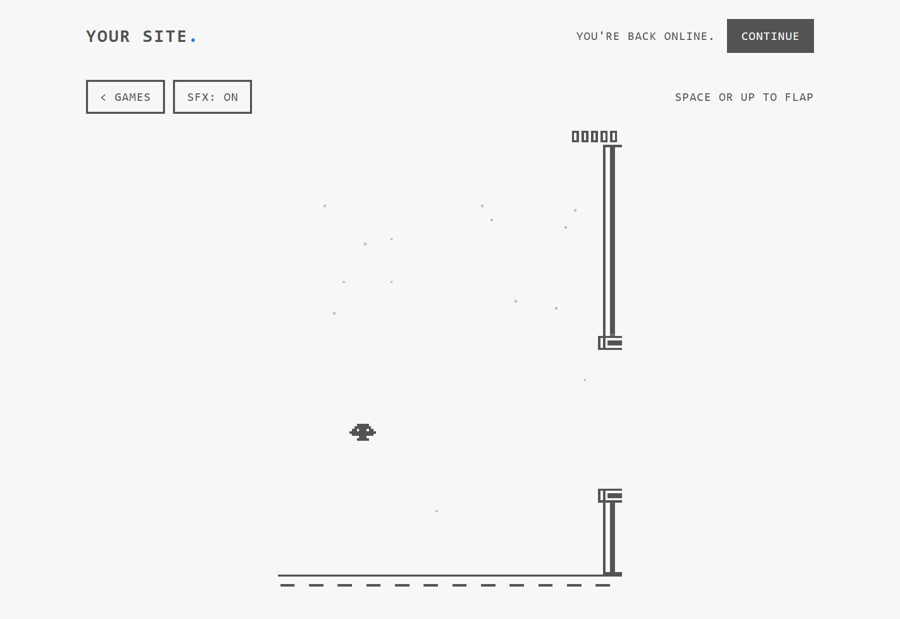

# Offline Arcade 🕹️

**Give your website its own "Chrome dinosaur" experience.** When a visitor's connection drops, a page fails to load, or a page is taking forever, they get four nostalgic mini pixel games instead of the browser's generic error screen. When the page is ready, a single tap takes them right back to where they were.

Works on any website: plain HTML, Next.js, Vite, React, Astro, WordPress, Rails, and more. Packaged as an **agent skill** so you can ask any AI coding assistant to install it automatically.



| Astro Run 🚀 | Hopper 🦘 | Dark Mode 🌙 |
|---|---|---|
|  |  |  |

| Snake 🐍 | Flappy 🛸 | Retro SFX 🔊 |
|---|---|---|
|  |  | 8-bit Audio with Mute Toggle |

## 🎮 What Visitors Get

- **No internet, or server unreachable:** Any page of your site shows the arcade instead of the browser's error page. When the connection comes back, a **Continue** button takes them straight to the page they wanted.
- **A slow page** (still loading after 6 seconds): The games appear while the page keeps loading in the background. An **Open page** button appears as soon as it's ready, and opening it is instant.
- **Connection drops mid-visit:** A sleek unobtrusive offline bar offers **Play**.
- **Four Games with 8-Bit SFX:**
  - 🚀 **Astro Run:** Lunar astronaut jumping over space boulders, glowing alien crystals, and dodging hovering UFO probes with jetpack sparks.
  - 🦘 **Hopper:** Doodle-jump style arcade game — bounce up solid ledges, launch from super springs, and navigate moving & crumbling platforms.
  - 🐍 **Snake:** Classic snake with directional animated eyes, cosmic bonus stars (+25 pts), and juicy particle bursts.
  - 🛸 **Flappy:** Jet Bird with aviator goggles dodging sci-fi energy pylons with glowing emitters.
- **Controls & Features:** Works with keyboard, mouse, swipe, and mobile touch. Remembers high scores in local storage, supports Light and Dark modes, and includes toggleable 8-bit sound effects.

### The One Limit

It works for anyone who has opened your site **once** while online. On that first visit, the browser quietly caches the arcade (~30 KB). A device that has never loaded your site has nothing cached yet, so the browser shows its default offline page. That is true for every website on the internet; only the browser vendor controls the first-touch screen.

---

## 🤖 Add It with an AI Agent (Recommended)

This repository is formatted as an [agent skill](https://docs.claude.com/en/docs/agents-and-tools/agent-skills/overview). [SKILL.md](SKILL.md) instructs any AI agent step-by-step how to integrate the files, match your site's branding colors and name, exclude sensitive routes (login, checkout, admin), check security headers, and verify the setup.

**Claude Code:**

```bash
git clone https://github.com/aasif-md1/offline-arcade ~/.claude/skills/offline-arcade
```

Then in your project simply say:
> *"Add the offline arcade to this site."*

**Other Agents** (Cursor, Codex, Gemini CLI, Copilot, Windsurf):
Clone the repo and instruct your agent:
> *"Follow the instructions in path/to/offline-arcade/SKILL.md to add the offline arcade to this site."*

---

## 🛠️ Add It by Hand

1. Copy `assets/arcade.js`, `assets/arcade-sw.js`, and `assets/arcade-offline.html` into your public root folder (`public/`, `static/`, or next to `index.html`). They must be served from the root: e.g. `https://your-site.com/arcade-sw.js`.
2. Add this tag to the `<head>` of every page:
   ```html
   <script src="/arcade.js" async></script>
   ```
3. In `arcade-offline.html`, customize your site name in `.logo`, colors in `:root`, and copy in `COPY` (all marked `CUSTOMIZE`).
4. In `arcade-sw.js`, add your login, auth, API, and checkout routes to `SKIP_PATHS`.
5. Deploy over HTTPS, visit the site once, then simulate offline (DevTools → Network → Offline) and reload.

Read `references/frameworks.md` for specific framework instructions (Next.js, Vite, Astro, Nuxt, etc.). If your site runs on both `www.` and apex domains, see `references/twin-domain.md`.

---

## 🧪 Testing

```bash
npm i --no-save puppeteer
node scripts/verify.mjs https://www.example.com
node scripts/verify.mjs https://www.example.com --twin https://example.com
```

To test locally during development on `localhost`:
Run `localStorage.setItem("arcade-dev", "1")` in the browser console. The arcade stays off on localhost by default so it doesn't interfere with dev servers.

---

## ⚙️ Configuration

| Where | Setting | Default | Description |
|---|---|---|---|
| `arcade-sw.js` | `SLOW_MS` | `6000` | Milliseconds before a slow page switches to the games (`0` = offline only) |
| `arcade-sw.js` | `SKIP_PATHS` | auth, admin, checkout | Paths that never switch while slow and are never cached |
| `arcade-sw.js` | `VERSION` | `"v2"` | Bump whenever `arcade-offline.html` changes so visitors receive the update |
| `arcade.js` | `MESSAGE`, `BUTTON` | English copy | Text on the mid-visit offline bar |
| `arcade.js` | `BAR_BG`, `ACCENT` | Dark bar, blue accent | Colors for the offline notice |
| `arcade.js` | `TWIN_ORIGIN` | off | Your alternative domain (apex or www) |
| `arcade-offline.html` | Branding & copy | `Your Site` | Logo, colors, typography, and game hints |

---

## 🌐 Browser Support

Any browser supporting modern Service Workers: Chrome, Edge, Safari (macOS & iOS), Firefox, Brave, Samsung Internet.

## 📄 License

MIT. Built with ❤️ for the web.
